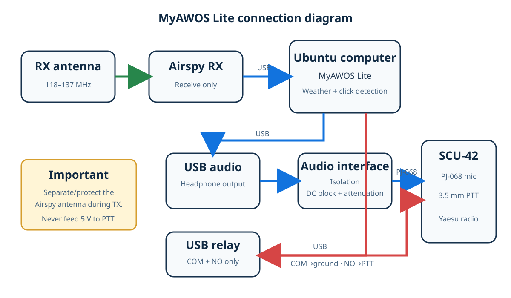

# Wiring and connections

## Airspy receiver

1. Connect the receive antenna to the Airspy.
2. Connect the Airspy directly to a USB port on the computer.
3. Keep its antenna and feed line separated from the transmitting antenna.

## USB relay PTT

The relay must act only as an isolated contact closure:

| Relay terminal | Connection |
|---|---|
| COM | Radio/PTT ground |
| NO | SCU-42 PTT conductor |
| NC | Unused |

When inactive, NO must be open. When active, the relay connects PTT to ground.
Confirm this with a continuity meter before attaching the radio. Never place
USB voltage on COM, NO, or the SCU-42 PTT cable.

## Audio

1. Connect the USB audio adapter to the computer.
2. Connect its headphone output to the isolated/attenuated interface.
3. Connect the interface's PJ-068 male plug to the SCU-42 microphone jack.
4. Connect the relay PTT cable to the SCU-42 3.5 mm PTT jack.
5. Insert the SCU-42 fully into the Yaesu MIC/SP jack and secure both screws.

The PJ-068 is 0.206 inch (5.2 mm), not a standard 6.35 mm or 3.5 mm plug.

## First power-up

1. Leave the radio off.
2. Install MyAWOS Lite; transmission remains disabled.
3. Run `sudo myawos-lite relay-off`.
4. Confirm COM–NO is open afterward.
5. Turn on the radio and use `myawos-lite play-audio`; the radio must not key.
6. Perform a brief controlled PTT test only after verifying the frequency,
   antenna or dummy load, authorization, audio level, and automatic PTT release.
